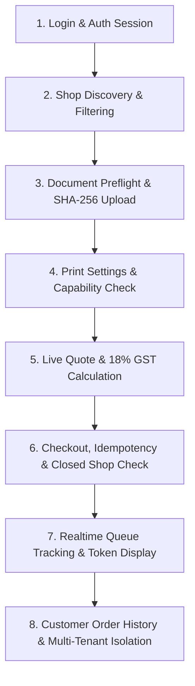

# Customer Module Acceptance & E2E Gate (P04-M07-F01)

This directory houses the comprehensive End-to-End (E2E) customer journey acceptance suites and accessibility/security compliance verifications for **Phase 04 (Customer Web)** of the Cloud Automated Printing Solution (CAPS).

---

## 1. Test Coverage & User Journey Trace

The E2E test suite in `customer-journey.e2e.test.ts` exercises the full customer lifecycle against contract-first mocks:



| Step | Tested Module | Invariants Verified |
|---|---|---|
| **1. Auth & Session** | `features/auth` | JWT tokens stored, role validation, customer-scoped permissions. |
| **2. Shop Discovery** | `features/shop-discovery` | Geolocation fallback, distance sorting, capability inspection. |
| **3. Document Upload** | `features/document-upload` | MIME validation, size limit (<50MB), SHA-256 integrity, page counting. |
| **4. Print Settings** | `features/print-settings` | Hardware restriction enforcement, anti-silent downgrade. |
| **5. Live Quote** | `features/pricing` | Dynamic duplex/color rates, 18% GST, express priority surcharge, ETA. |
| **6. Checkout** | `features/checkout` | Idempotency locking, closed shop rejection, pay-at-counter policy. |
| **7. Queue Tracking** | `features/queue-tracking` | Token card, 2-tier priority, realtime wake-up, fetch-on-reconnect. |
| **8. Order History** | `features/orders` | Strict tenant isolation (Customer Beta cannot view Customer Alpha). |

---

## 2. Accessibility & Security Verification

The suite in `accessibility-security.test.ts` validates:
1. **WCAG 2.1 AA Semantic Accessibility**:
   - Status messages declare `role="status"` and `aria-live="polite"`.
   - Error banners declare `role="alert"` and `aria-live="assertive"`.
   - Interactive buttons have explicit `aria-label` accessible names.
2. **Zero Secret Leakage**:
   - Automated regex scanning of all frontend source files ensuring no Supabase service-role keys or payment gateway private secrets exist.
3. **Zero-Knowledge Privacy**:
   - 24-hour auto-delete deadline strictly enforced on document records.

---

## 3. Running Acceptance Tests

```bash
# Execute full customer-web test suite including E2E acceptance
pnpm --filter @caps/customer-web test

# Execute only E2E acceptance tests
pnpm --filter @caps/customer-web test tests/e2e/customer-journey.e2e.test.ts
```

---

## 4. Multi-Developer Integration Gate Note

Per Multi-Developer Rule #5:
- All customer acceptance tests are hosted within `apps/customer-web/tests/e2e/` to respect the strict path allowlist (`apps/customer-web/**`).
- When Phase 6 integration testing commences across all 4 apps, the integration maintainer may create a symlink or root runner in `tests/e2e/customer/` targeting this verified suite.
