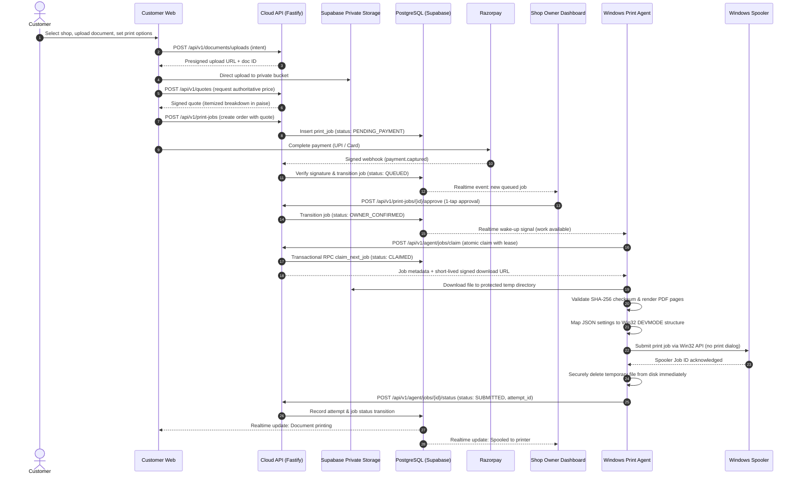

# CAPS — System Architecture & Data Flow Baseline

> **Document:** `docs/architecture/overview.md`  
> **Status:** Architecture Baseline Locked  
> **Source Documents:** `MINI_PROJECT_I_CAPS_SRS.md`, `implementation-plan.md`

---

## 1. Executive System Overview

CAPS (Cloud Automated Printing Solution with User-Side Configuration) standardizes and automates the print-ordering pipeline between customers and local photocopy/print shops. It eliminates manual document transfer (WhatsApp/Bluetooth), manual print configuration, and ad-hoc queue management.

The platform connects three distinct physical actors:
1. **The Customer:** Discovers shops, uploads documents, configures native print parameters (paper, color, duplex, orientation, copies, page range, binding), selects an execution priority tier (`Urgent` vs. `Flexible`), and pays online.
2. **The Shop Owner / Operator:** Monitors a live shop-specific FIFO queue, confirms print execution with a single tap, configures printer routing, and reviews financial/operational analytics.
3. **The Physical Printer:** An arbitrary USB or LAN printer attached to the shop's Windows PC, driven by the local Windows Print Spooler and manufacturer drivers.

---

## 2. Three-Tier Layered Architecture

```text
┌────────────────────────────────────────────────────────────────────────┐
│                              Cloud Layer                               │
│  - Identity & Role Enforcement (Customer, Owner, Admin)               │
│  - Document Intake & Private Object Storage                            │
│  - Authoritative Pricing Calculation (in integer paise)               │
│  - Payment Verification & Webhook Ingestion (Razorpay)                 │
│  - Two-Tier Queue Orchestration (Urgent vs Flexible FIFO)              │
│  - Realtime Change Fan-Out (WSS Signal) & Push Notifications (FCM)     │
└───────────────────────────────────┬────────────────────────────────────┘
                                    │
                  Outbound HTTPS / WSS (No public inbound ports)
                                    ▼
┌────────────────────────────────────────────────────────────────────────┐
│                           Local Agent Layer                            │
│  - Authenticated Outbound Connection to Cloud API                      │
│  - Device Pairing & Scoped Credential Management                       │
│  - Transactional Job Claiming with Leases & Attempt IDs                │
│  - Transient Encrypted Document Download & Local Integrity Check       │
│  - PDF Rendering & Native DEVMODE Settings Mapping                     │
│  - Silent Submission to OS Spooler (Zero User-Facing Print Dialogs)    │
│  - Immediate Post-Submission Local File Deletion                       │
│  - Spooler Outcome Monitoring & Offline SQLite Reconnection Buffer     │
└───────────────────────────────────┬────────────────────────────────────┘
                                    │
                        Win32 Print Spooler API
                                    ▼
┌────────────────────────────────────────────────────────────────────────┐
│                            Hardware Layer                              │
│  - Windows 10/11 Print Spooler Subsystem                               │
│  - Manufacturer Printer Drivers (Canon, HP, Epson, Brother, Ricoh)    │
│  - Physical USB / LAN / Wi-Fi Attached Printer Hardware                │
└────────────────────────────────────────────────────────────────────────┘
```

---

## 3. High-Level End-to-End Data Flow



---

## 4. Fundamental Architectural Invariants

1. **Owner Confirmation Precedes Spooler Submission:**
   In the MVP, every job must receive explicit owner confirmation before the agent submits it to the spooler. This resolves the sequencing error in SRS §6 UC-2 and prevents accidental paper/toner consumption.
2. **Spooler Acceptance $\neq$ Guaranteed Paper Output:**
   An integer `spooler_job_id` proves only that the OS spooler received the raster stream. Physical jams, out-of-paper states, or driver stalls can occur subsequently. The agent tracks spooler states and reports errors rather than assuming completion.
3. **No Blind Auto-Reprints:**
   If the agent or shop PC restarts mid-execution, previously claimed jobs with uncertain status transition to `UNKNOWN_REQUIRES_REVIEW`. The system never silently auto-reprints to avoid duplicate charges or physical waste.
4. **Outbound-Only Agent Topology:**
   The desktop agent never exposes a public server. It initiates outbound HTTPS/WSS connections to Cloud API. Any local diagnostic interface binds strictly to `127.0.0.1`.
5. **Transactional Queue Claiming:**
   Jobs are claimed atomically by the authenticated agent using database-level locking (`FOR UPDATE SKIP LOCKED`) and short-lived leases to eliminate dual-execution race conditions.
6. **Zero Raw Content in Telemetry:**
   Logs, metrics, event stores, and database audit tables store only metadata (page count, settings, timestamps, hashes). Customer document content is never logged.
