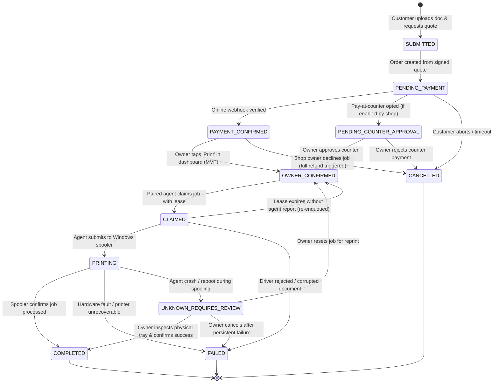
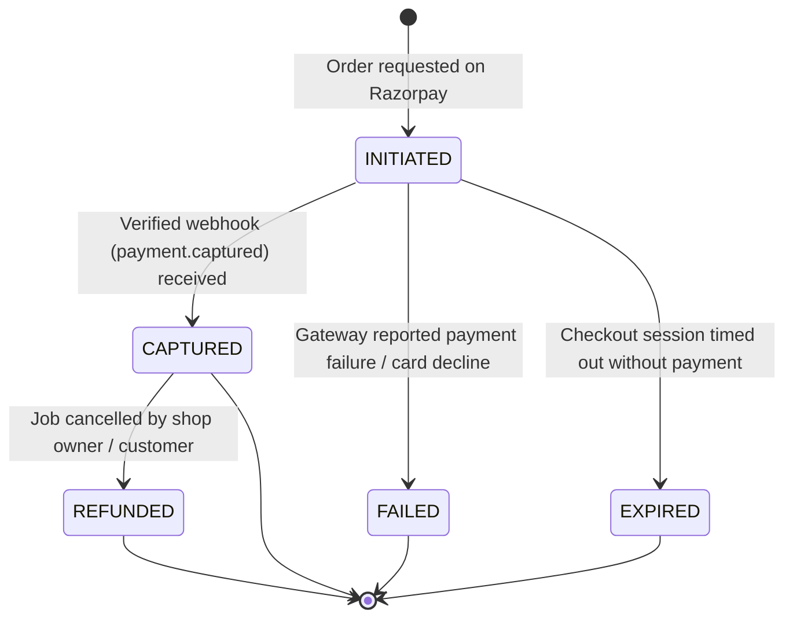

# CAPS — Lifecycle State Machines

> **Document:** `docs/architecture/state-machines.md`  
> **Status:** Architecture Baseline Locked  
> **Related Contracts:** `@caps/types` (`jobs.ts`, `payments.ts`, `agent.ts`), `packages/print-contracts/schema/`

---

## 1. Print Job Lifecycle

A CAPS print job transitions through a strictly validated, 10-state lifecycle. State transitions are verified by Cloud API business logic and recorded in an immutable `job_events` audit table.

### State Definitions

| State | Responsibility | Description |
|---|---|---|
| `SUBMITTED` | Customer Web | Temporary state during configuration and quote calculation. |
| `PENDING_PAYMENT` | Cloud API / Customer | Order created, awaiting payment gateway confirmation or counter opt-in. |
| `PAYMENT_CONFIRMED` | Cloud API | Payment verified via signed Razorpay webhook; job placed into shop's FIFO queue. |
| `PENDING_COUNTER_APPROVAL` | Owner Dashboard | Pay-at-counter selected; job queued conditionally, pending cash receipt confirmation. |
| `OWNER_CONFIRMED` | Owner Dashboard | Owner confirmed job; eligible for desktop agent atomic claim. |
| `CLAIMED` | Print Agent | Paired agent claimed job with active lease; temporary download & render in progress. |
| `PRINTING` | Print Agent | Document raster submitted to Windows spooler; `spooler_job_id` issued. |
| `COMPLETED` | Print Agent / Spooler | Spooler finished spooling; physical paper delivered. Ready for pickup notification sent. |
| `FAILED` | Cloud API / Agent | Submission error, unsupported printer capabilities, or spooler abort. |
| `CANCELLED` | Customer / Owner | Cancelled before execution; initiates refund process if already paid. |
| `UNKNOWN_REQUIRES_REVIEW` | Exception / Recovery | Agent recovered from unexpected reboot while job was spooled; manual inspection required. |

---

## 2. Payment Lifecycle

Payment verification is executed strictly on the server side. Client-side callbacks alone are never trusted to transition a job to paid.

---

## 3. Desktop Agent Attempt & Lease Lifecycle

To guarantee transactional safety across network disconnects and competing shop agents:

1. **Lease Grant:** When an agent invokes `POST /api/v1/agent/jobs/claim`, Cloud API locks the job row, sets `status = CLAIMED`, issues a unique `attempt_id` and a `lease_token` valid for 120 seconds.
2. **Heartbeat / Renewal:** If rendering or downloading takes longer than expected, the agent extends the lease via `POST /api/v1/agent/jobs/{id}/lease-renew`.
3. **Completion or Failure:** The agent submits a signed status report (`POST /api/v1/agent/jobs/{id}/status`) containing the matching `attempt_id`, `lease_token`, and `Idempotency-Key` header.
4. **Stale Recovery:** A background worker on Cloud API inspects active leases. Any lease expired by >30 seconds without an agent heartbeat transitions the job back to `OWNER_CONFIRMED` and logs a recovery audit event.
