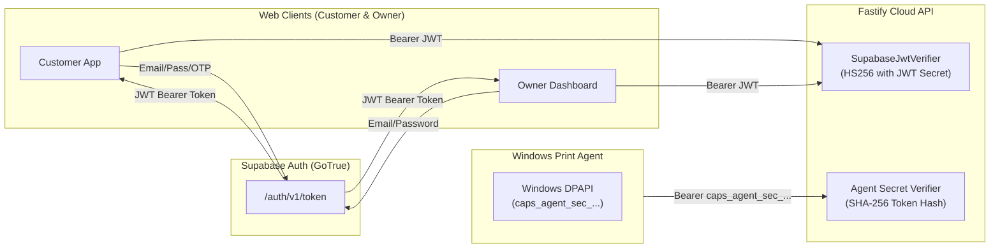

# CAPS — Phase 8: Live System Integration Audit
## Comprehensive Repository, Architecture & Contract Audit

> **Document:** `docs/integration/INTEGRATION_AUDIT.md`  
> **Status:** Active Master Reference  
> **Target Release:** CAPS Phase 8 Live Integration  
> **Audited Baseline:** CAPS Monorepo (Next.js Customer Web, Next.js Owner Dashboard, Fastify Cloud API, Python Print Agent, Supabase PostgreSQL, Shared Contracts)  
> **Author:** Senior Software Architect & Integration Engineer  

---

## 1. Executive Summary & Audit Scope

CAPS (Cloud Automated Printing Solution) has reached the completion of its isolated module development phase. All four core applications have passed their module-level unit and contract mock tests:

1. **Customer Web (`apps/customer-web`):** 26 test suites (246 tests passing)
2. **Shop Owner Dashboard (`apps/owner-dashboard`):** 18 test suites (142 tests passing)
3. **Cloud Backend API (`apps/cloud-api`):** 34 test suites (397 tests passing)
4. **Desktop Print Agent (`apps/print-agent`):** Feasibility & engine tests passing with simulated adapters
5. **Shared Packages & Contracts (`packages/*`):** UI, Types, Config, Validation, API Client, Print Contracts

However, a rigorous inspection of the codebase reveals that **each application was developed against contract-first in-memory mocks, simulated transports, and isolated stubs**. The system currently cannot operate end-to-end because:
- Frontend apps are not wired to the running Fastify Cloud API or Supabase Realtime channels.
- Cloud API is running with in-memory Mock Repositories rather than persisting to the Supabase PostgreSQL database.
- Critical payload, endpoint naming, and casing mismatches exist between the Python Print Agent, Cloud API, and frozen JSON schemas.
- Configuration variables across `.env.example`, Fastify `env.ts`, and agent `config.py` diverge in naming and structure.

This audit provides a factual, code-referenced breakdown of the existing implementation, mock inventories, contract incompatibilities, and technical gaps required to bring CAPS to a fully unified, live integrated system.

---

## 2. Application-by-Application Implementation Status & Mock Inventory

### 2.1 Customer Web (`apps/customer-web`)

| Feature / Domain | UI & Business Logic Status | Live Integration Status | Real vs. Mock Implementation Details |
| :--- | :--- | :--- | :--- |
| **Authentication & Registration** | **Implemented** | **Live-Ready (Supabase)** | Uses `SupabaseAuthClient` (`src/features/auth/supabase-auth-client.ts`) talking to Supabase GoTrue Auth REST endpoints (`/auth/v1/token`, `/auth/v1/signup`, `/auth/v1/otp`). Supports browser cookie synchronization for Next.js Edge Middleware. |
| **Shop Discovery** | **Implemented** | **MOCKED (In-Memory)** | `ShopsService` (`src/features/shop-discovery/shops-service.ts#L13`) defaults to `MOCK_SHOPS` from `fixtures.ts`. It does **not** call `GET /api/v1/shops` on Cloud API or query `public.shops` in Supabase. |
| **Document Upload & Preflight** | **Implemented** | **MOCKED (In-Memory)** | `DirectUploadClient` (`src/features/document-upload/direct-upload-client.ts#L42`) stores upload intents in an internal `Map<string, InternalUploadIntent>()` and returns fake storage URLs (`https://storage.caps.local/v1/private/upload/...`). Does not call Cloud API `POST /api/v1/documents/uploads` or Supabase Storage S3 endpoints. |
| **Live Pricing Quotes** | **Implemented** | **MOCKED (Client-Side)** | `QuoteService` (`src/features/pricing/quote-service.ts#L8`) computes quotes client-side via `generateAuthoritativeQuote()` with artificial latency (`mockLatencyMs: 80`). Does not call Cloud API `POST /api/v1/quotes` for server-authoritative quotes. |
| **Print Settings Configuration** | **Implemented** | **Live-Ready Form Logic** | Settings form (`PaperSize`, `ColorMode`, `SideMode`, `Copies`, `PageRange`, `Binding`) enforces all client-side validation. Needs binding to real shop capability matrices returned from API. |
| **Checkout & Pending Order** | **Implemented** | **MOCKED (In-Memory)** | `CheckoutService` (`src/features/checkout/checkout-service.ts#L30-L35`) stores pending orders in an in-memory `idempotencyStore` Map and dispatches to `defaultOrdersService`. Does not call Cloud API `POST /api/v1/print-jobs` or Razorpay order initiation. |
| **Payment Integration (Razorpay)** | **Implemented UI** | **MOCKED (Simulation)** | Razorpay checkout initiation redirects to `/print/payment?orderId=...`. No live Razorpay SDK modal integration or webhook listening from customer client. |
| **Live Queue Tracking** | **Implemented** | **MOCKED (In-Memory)** | `QueueTrackingService` (`src/features/queue-tracking/queue-tracking-service.ts#L38`) reads from in-memory `OrdersService`. |
| **Realtime Updates** | **Implemented Logic** | **SIMULATED (Timer-Based)** | `RealtimeTrackingClient` (`src/features/queue-tracking/realtime-tracking-client.ts#L170`) simulates socket handshakes via `setTimeout(..., 50)` instead of connecting to a live Supabase Realtime channel. |
| **Push Notifications (FCM)** | **Implemented** | **SIMULATED** | `PushService` (`src/features/notifications/push-service.ts#L112`) simulates subscription with fake endpoints (`https://fcm.googleapis.com/fcm/send/caps-...`). |

---

### 2.2 Shop Owner Dashboard (`apps/owner-dashboard`)

| Feature / Domain | UI & Business Logic Status | Live Integration Status | Real vs. Mock Implementation Details |
| :--- | :--- | :--- | :--- |
| **Authentication & Role Guards** | **Implemented** | **Live-Ready + Fallback** | `SupabaseAuthClient` (`src/features/auth/supabase-auth-client.ts`) authenticates against Supabase Auth (`/auth/v1/token`), verifies `shop_owner` role, writes session cookies for Edge Middleware, and falls back to local demo accounts when offline. |
| **Tenant & Shop Scoping** | **Implemented** | **Live-Ready (PostgREST)** | `ShopService` (`src/features/shop-management/shop-service.ts#L39`) queries Supabase PostgREST directly (`GET /rest/v1/shops?owner_id=eq.${ownerId}`) with bearer token, falling back to `DEFAULT_DEMO_SHOP` in dev mode. |
| **Live Queue View** | **Implemented** | **Live-Ready (Cloud API + PostgREST)** | `LiveQueueService` (`src/features/live-queue/live-queue-service.ts`) targets Cloud API priority queue `/api/v1/shops/:shopId/queue` and Supabase PostgREST `/rest/v1/print_jobs`, strictly isolating tenant queues without mock fallbacks. |
| **1-Click Print Approval** | **Implemented** | **Mock / State Transition** | `ConfirmationService` (`src/features/print-confirmation/confirmation-service.ts`) transitions job state from `queued` to `approved`/`printing`. Must be wired to Cloud API `POST /api/v1/shops/:shopId/jobs/:jobId/approve` to trigger real agent dispatch. |
| **Printer Management** | **Implemented** | **Live-Ready (PostgREST)** | `PrinterService` (`src/features/printer-management/printer-service.ts#L88`) queries Supabase PostgREST (`/rest/v1/printers?shop_id=eq...`). Needs live agent capability sync. |
| **Pricing & Catalog Config** | **Implemented** | **Live-Ready (PostgREST)** | `PricingService` updates shop pricing directly in Supabase (`PATCH /rest/v1/shops?id=eq...`). |
| **Agent Device Pairing UI** | **Implemented** | **Mock / Partial API** | `AgentPairingModal` generates pairing codes. Calls Cloud API `POST /api/v1/shops/:shopId/agents/pairing-code` or uses mock fixtures. |
| **Realtime Queue Sync** | **Implemented Logic** | **SIMULATED (Timer-Based)** | `RealtimeQueueClient` (`src/features/live-queue/realtime-queue-client.ts#L69`) uses a 50ms `setTimeout` simulation rather than a live WebSocket connection to Supabase Realtime channel `realtime:shops:${shopId}`. |
| **Sales & Operational Reports** | **Implemented** | **Hybrid (PostgREST + Fixtures)** | `RevenueAnalyticsService` (`src/features/revenue-analytics/analytics-service.ts#L104`) queries `/rest/v1/print_jobs` with fallback to fixtures. |

---

### 2.3 Cloud Backend API (`apps/cloud-api`)

| Module / Route Namespace | Business Logic Status | Live Database / Provider Status | Real vs. Mock Implementation Details |
| :--- | :--- | :--- | :--- |
| **Server Core & Fastify Plugins** | **Fully Implemented** | **Production-Grade** | Fastify 5.x server with CORS, sliding-window rate limiting, structured Pino logging, request ID tracing, global error envelopes conforming to SRS §5.4. |
| **Auth Plugin & JWT Verification** | **Implemented** | **Live-Ready (HS256)** | `SupabaseJwtVerifier` (`src/plugins/auth.ts#L80`) validates HMAC-SHA256 Supabase JWTs. **Gap:** Does not support agent device secret tokens (`caps_agent_sec_...`). |
| **Shop Management (`/api/v1/shops`)** | **Fully Implemented** | **MOCKED (In-Memory)** | In `app.ts#L208`, `shopsRepo` defaults to `new MockShopsRepository()`. No PostgreSQL / Supabase client implementation exists. Data resets on process restart. |
| **Printer Management (`/api/v1/shops/:id/printers`)** | **Fully Implemented** | **MOCKED (In-Memory)** | In `app.ts#L209`, `printersRepo` defaults to `new MockPrintersRepository()`. |
| **Document Storage & Conversion (`/api/v1/documents`)** | **Fully Implemented** | **MOCKED Storage** | Uses `MockDocumentsRepository` and `MockStorageService`. Document converter sandbox uses basic Node buffers. Does not connect to real Supabase S3 Private Storage bucket. |
| **Authoritative Pricing (`/api/v1/quotes`)** | **Fully Implemented** | **Live-Ready Logic** | Mathematical pricing calculation engine (integer paise, non-negative, GST, binding, urgent surcharge) is fully implemented. Uses `MockQuotesRepository`. |
| **Print Job Lifecycle (`/api/v1/print-jobs`)** | **Fully Implemented** | **MOCKED (In-Memory)** | Complete state machine (`pending_payment` $\rightarrow$ `queued` $\rightarrow$ `approved` $\rightarrow$ `claimed` $\rightarrow$ `downloading` $\rightarrow$ `printing` $\rightarrow$ `completed` / `failed`) implemented with `MockPrintJobsRepository`. |
| **Agent Pairing & Leases (`/api/v1/agents`)** | **Fully Implemented** | **MOCKED (In-Memory)** | Pairing code generator, device registration, and atomic lease claims implemented with `MockAgentsRepository` and `MockJobAttemptsRepository`. |
| **Payments & Razorpay (`/api/v1/payments`)** | **Implemented** | **MOCKED by Default** | `createRazorpayClient` defaults to mock mode unless real `RAZORPAY_KEY_ID` and `RAZORPAY_KEY_SECRET` are provided. Webhook replay protection and signature verification are fully implemented. |
| **Push Notifications (`/api/v1/notifications`)** | **Implemented** | **MOCKED (In-Memory)** | Uses `MockFirebaseClient`, `MockUserFcmTokensRepository`, and `MockNotificationOutboxRepository`. Real Firebase Admin SDK is not initialized. |
| **Document Privacy Cleanup Job** | **Implemented** | **In-Memory Worker** | `DocumentCleanupJob` and `PrivacyCleanupWorker` run on an interval, scanning mock repositories for expired jobs and orphan documents. |

---

### 2.4 Windows Print Agent (`apps/print-agent`)

| Component / Subsystem | Implementation Status | Live Hardware / OS Status | Real vs. Mock Implementation Details |
| :--- | :--- | :--- | :--- |
| **Cloud API Client (`api_client.py`)** | **Implemented** | **Live-Ready HTTP** | Full `urllib.request` client with bearer token headers, retry with exponential backoff, SHA-256 download verification, and 401 handling. |
| **Realtime Listener (`realtime_client.py`)** | **Implemented Logic** | **SIMULATED Transport** | Uses `SimulatedWebSocketTransport` by default (`realtime_client.py#L282`). Real WebSocket / Supabase Realtime client is not connected. |
| **Atomic Claim & Dispatcher (`dispatcher.py`)** | **Implemented** | **Live-Ready Logic** | Serialized per-printer queue dispatch, attempt state machine, and atomic HTTP lease acquisition before printing. |
| **Device Pairing Manager (`pairing.py`)** | **Implemented** | **Live-Ready Logic** | Ephemeral code exchange via `/api/v1/agent/pair` with local credential persistence in DPAPI / JSON store. |
| **Settings Mapper (`settings_mapper.py`)** | **Implemented** | **Windows-Ready (wingdi.h)** | Maps print settings to Win32 `DEVMODE` fields (`dmPaperSize`, `dmOrientation`, `dmColor`, `dmDuplex`, `dmCopies`). |
| **PDF Rendering Engine (`pdf_renderer.py`)** | **Implemented** | **Live-Ready (pypdfium2)** | High-fidelity PDF page rendering, page range slicing, and geometry scaling to printable printer margins. |
| **Windows Spooler Adapter (`windows_spooler.py`)** | **Implemented** | **Platform-Conditional** | Direct Win32 Print Spooler submission (`win32print.StartDocPrinter`, `StartPagePrinter`, `WritePrinter`). Falls back to `SimulatedSpoolerAdapter` on non-Windows. |
| **Spooler Health Monitor (`spooler_monitor.py`)** | **Implemented** | **Platform-Conditional** | Polls `win32print.GetJob` for paper jams, out of paper, and user intervention flags. |
| **Local SQLite State Storage (`storage/db.py`)** | **Implemented** | **Live-Ready (SQLite)** | Persistent local SQLite database for in-flight attempt tracking, idempotency, and crash recovery. |
| **System Tray UI & Diagnostics (`tray/`)** | **Implemented** | **Platform-Conditional** | `pystray` Windows system tray icon and loopback-only diagnostic HTTP server on `127.0.0.1:9099`. |

---

## 3. Database & Supabase Migration Foundation Audit

The repository contains 14 sequential PostgreSQL migrations in `supabase/migrations/`:

```text
supabase/migrations/
├── 20261019000001_create_users_and_shops.sql                     (Profiles, shops, membership, handle_new_user trigger)
├── 20261019000002_create_printers_and_agents.sql                 (Physical printers, agent devices, sessions, RLS)
├── 20261019000003_create_jobs_and_payments.sql                   (Print jobs, payment transactions, state machine)
├── 20261019000004_create_attempts_events_privacy.sql             (Job attempts, audit events, document deletion logs)
├── 20261019000005_create_queue_priority_and_eta.sql              (get_shop_queue RPC, FIFO priority sorting, ETAs)
├── 20261019000006_create_urgent_cap_and_fairness.sql             (Hourly urgent cap enforcement, window validation)
├── 20261019000007_create_notifications_schema.sql                (FCM device tokens, notification outbox, dispatch)
├── 20261019000008_create_atomic_priority_queue.sql               (claim_next_approved_job RPC, atomic advisory locks)
├── 20261019000009_create_claim_leases_and_recovery.sql           (Claim lease tokens, heartbeat extension, recovery RPC)
├── 20261019000010_create_agent_pairing_and_codes.sql             (Ephemeral pairing codes, DPAPI secrets hashing)
├── 20261019000011_create_realtime_events_and_reconciliation.sql   (realtime_events table, publication to supabase_realtime)
├── 20261019000012_create_privacy_cleanup_and_unresolved_rpc.sql  (Hard deletion workers, unresolved attempt audits)
├── 20261019000013_create_documents_schema.sql                    (documents table, S3 private keys, checksums)
└── 20261019000014_create_document_retention_and_audit_cleanup.sql (Strict 24h retention deadline triggers)
```

### Database Strengths:
1. **Authoritative State Machine:** Status checks enforce `pending_payment` $\rightarrow$ `queued` $\rightarrow$ `approved` $\rightarrow$ `claimed` $\rightarrow$ `downloading` $\rightarrow$ `printing` $\rightarrow$ `completed` / `failed`.
2. **Two-Tier Priority Queue:** `claim_next_approved_job` and `get_shop_queue` preserve FIFO within tiers while giving Urgent jobs class precedence.
3. **Tenant-Scoped Row-Level Security (RLS):** Every table is locked down with `ENABLE ROW LEVEL SECURITY`. Customers can only read their own profiles and jobs; shop owners are restricted to shops matching `owner_id = auth.uid()`.
4. **Hard Delete & Privacy Automation:** Triggers compute `document_expires_at = now() + interval '24 hours'` and purge unprinted files.

### Integration Gaps in Database:
1. **Disconnected Cloud API:** `apps/cloud-api` has **no database client** connecting to PostgreSQL. All Cloud API routes use in-memory JS Maps instead of querying these tables!
2. **Realtime Publication Configuration:** `supabase_realtime` publication includes `realtime_events`, but neither frontend nor the print agent currently listens to the real WebSocket channel.

---

## 4. Cross-Application Contract & Interface Incompatibilities

During our audit, several critical interface divergences were identified between applications:

### Issue 1: Agent Endpoint Naming Mismatch (Singular vs. Plural)
- **Frozen OpenAPI Contract (`packages/print-contracts/openapi/v1.json`):** Defines `/agent/heartbeat`, `/agent/jobs/claim`, and `/agent/jobs/{job_id}/status`.
- **Python Print Agent (`api_client.py#L360-L450`):** Calls `/api/v1/agent/heartbeat`, `/api/v1/agent/jobs/claim`, and `/api/v1/agent/jobs/status`.
- **Cloud API (`agents.routes.ts#L190-L380`):** Implemented plural routes: `/api/v1/agents/heartbeat`, `/api/v1/agents/claim`, and `/api/v1/agents/status`.
- **Impact:** The Python print agent receives `404 Not Found` for all heartbeat, claim, and status calls when pointed at Cloud API.

### Issue 2: Agent Pairing Payload Schema Divergence
- **Cloud API (`agents.routes.ts#L56-L61`):** Requires:
  ```typescript
  { pairing_code: string, device_fingerprint: string, device_name: string, agent_version?: string }
  ```
- **Python Print Agent (`pairing.py#L85-L90`):** Sends:
  ```python
  { "pairing_code": code, "hostname": platform.node(), "os_version": platform.platform(), "agent_version": agent_version }
  ```
- **Impact:** Pairing handshake fails with `400 INVALID_PAYLOAD: device_fingerprint is required, device_name is required`.

### Issue 3: Job Status Update Casing & Mandatory Fields Mismatch
- **Frozen Contract (`job-status-update-request.schema.json`):**
  - `status`: **UPPERCASE** enum (`CLAIMED`, `DOWNLOADING`, `RENDERING`, `PRINTING`, `COMPLETED`, `FAILED`).
  - Required fields: `contract_version`, `job_id`, `attempt_id`, `lease_token`, `status`, `pages_printed`, `total_pages`, `timestamp`.
- **Python Print Agent (`api_client.py#L430-L445`):**
  - Sends **lowercase** status (`downloading`, `printing`, `completed`, `failed`).
  - Omits `lease_token`, `pages_printed`, `total_pages`, and `contract_version`.
- **Impact:** Cloud API schema validation rejects all execution updates from the Windows agent with `400 INVALID_PAYLOAD`.

### Issue 4: Job Claim Response Structure (Nested vs. Flat)
- **Frozen Contract (`job-claim-response.schema.json`):**
  ```json
  { "contract_version": "1.0.0", "claimed": true, "job": { "job_id": "...", "attempt_id": "...", "lease_token": "..." } }
  ```
- **Python Print Agent (`api_client.py#L383-L393`):**
  Expects `job_id`, `attempt_id`, `lease_id` flattened at the root of the JSON response:
  ```python
  job_id = resp.get("job_id")  # Fails! Returns None because it is nested under resp["job"]
  ```
- **Impact:** Agent fails to claim any job, throwing `ContractValidationError: Cloud returned incomplete JobClaimResponse`.

### Issue 5: Print Settings Field Discrepancy (`duplex` vs. `sides`)
- **Shared Types & Web Apps (`packages/types/src/settings.ts`):** Uses `sides: 'single' | 'double'`.
- **Print Contracts Schema (`packages/print-contracts/schema/common.schema.json`):** Uses `duplex: 'simplex' | 'duplex_long' | 'duplex_short'`.
- **Impact:** Validating print jobs against `job-claim-response.schema.json` fails on the Python agent if `sides` is present instead of `duplex`.

---

## 5. Security & Authentication Architecture Audit



### Security Findings & Verification:
1. **Service-Role Key Protection:** Verified that `assertNoServerSecrets()` in both `apps/customer-web` and `apps/owner-dashboard` throws a hard fatal error if `SUPABASE_SERVICE_ROLE_KEY` is present in web bundles.
2. **Agent Token Verification Gap:** Cloud API's `auth.ts` only implements `SupabaseJwtVerifier`, which expects 3-part JWTs. When the paired agent sends `Authorization: Bearer caps_agent_sec_<hex>`, the JWT parser fails with `401 Malformed JWT`. A dedicated composite token verifier is required.
3. **Outbound-Only Agent Constraint:** Conforms strictly to architecture. The agent never opens inbound listening ports to the LAN or internet; all communication with Cloud API and Supabase Realtime is outbound. Local diagnostics listen strictly on `127.0.0.1:9099`.

---

## 6. Audit Conclusion & Integration Readiness

The CAPS codebase features exceptionally high-quality unit architectures, clean modular separation, and strict domain boundaries. Every piece of business logic (pricing, queue sorting, Win32 spooler mapping, PDF rendering, Edge middleware) is fully written and tested.

However, the system is in an **isolated island state**:
- Customer Web is an island running in-memory mocks.
- Owner Dashboard is an island running on Supabase PostgREST stubs with fallback fixtures.
- Cloud API is an island serving mock in-memory stores.
- Windows Print Agent is an island running against simulated transports and stubs.

Transitioning to Phase 8 requires bridging these four islands by executing prioritized, contract-aligned integration workstreams without breaking existing module ownership.
