# CAPS — Live System Integration Tasks & Work Partition

> **Document:** `docs/integration/INTEGRATION_TASKS.md`  
> **Status:** Draft / Proposed for Review  
> **Author:** Senior Integration Architect  
> **Target Release:** Phase 8 Live System Integration  
> **Monorepo Baseline:** `implementation-plan.md`, `TASK_MANIFEST.json`, `docs/development/ownership-map.md`

---

## 1. Executive Summary & Integration Architecture

This document defines the actionable, dependency-ordered engineering workstreams required to transition CAPS from four independently tested applications into a unified, authenticated, end-to-end production printing system.

### Four-Developer Work Partitioning
All tasks are allocated strictly according to the monorepo module ownership map ([`docs/development/ownership-map.md`](file:///Users/armanmulla/CAPS/docs/development/ownership-map.md)):
- **Track 1 (Developer 1):** Customer Web Experience (`apps/customer-web/`, `packages/ui/`, `packages/api-client/`)
- **Track 2 (Developer 2):** Shop Owner Operations Dashboard (`apps/owner-dashboard/`, `packages/ui/`, `packages/api-client/`)
- **Track 3 (Developer 3):** Cloud API, Supabase Database & Payment Core (`apps/cloud-api/`, `supabase/`, `packages/types/`, `packages/validation/`, `packages/print-contracts/`)
- **Track 4 (Developer 4):** Windows Desktop Print Agent & Win32 OS Integration (`apps/print-agent/`, `packages/print-contracts/`, `infra/windows/`)

---

## 2. Checkpoint Dependency Flow

```mermaid
flowchart TD
    subgraph CP1["Checkpoint 8.1: Contract, Endpoint & Auth Harmonization"]
        T3_1["INT-D3-01: Agent Endpoints & Schema Baseline"]
        T3_2["INT-D3-02: Composite Auth (JWT + Agent Device Token)"]
        T4_1["INT-D4-01: Python Agent Client & Contract Alignment"]
        T1_1["INT-D1-01: Customer Settings & Contract Harmonization"]
        T2_1["INT-D2-01: Owner Dashboard Enums & Types Alignment"]
    end

    subgraph CP2["Checkpoint 8.2: Database Persistence & Storage Service"]
        T3_3["INT-D3-03: Supabase Repositories & Transactional RPC"]
        T3_4["INT-D3-04: Supabase Storage & Presigned URLs"]
        T4_2["INT-D4-02: Agent Secure Presigned PDF Downloader"]
    end

    subgraph CP3["Checkpoint 8.3: Realtime Transport & Agent Event Bus"]
        T3_5["INT-D3-05: Realtime DB Webhooks & Broadcast Engine"]
        T4_3["INT-D4-03: Agent Realtime WebSocket Reconnect Client"]
        T2_2["INT-D2-02: Owner Dashboard Live Queue Realtime Wire"]
        T1_2["INT-D1-02: Customer Order Tracking Realtime Wire"]
    end

    subgraph CP4["Checkpoint 8.4: Payment Capture & Operator Print Approval"]
        T3_6["INT-D3-06: Razorpay Webhook & Payment Verification"]
        T1_3["INT-D1-03: Customer Web Checkout & Payment Modal"]
        T2_3["INT-D2-03: Owner Dashboard 1-Click Print Approval Wire"]
    end

    subgraph CP5["Checkpoint 8.5: Spooler Execution, Hardware Faults & Hard Purge"]
        T4_4["INT-D4-04: Win32 Spooler Execution & Fault Trapping"]
        T4_5["INT-D4-05: Desktop Immediate Post-Print Hard Purge"]
        T3_7["INT-D3-07: Cloud Document Retention & Storage Purge Worker"]
        T2_4["INT-D2-04: Owner Dashboard Hardware Status & Alerting"]
    end

    CP1 --> CP2
    CP2 --> CP3
    CP3 --> CP4
    CP4 --> CP5
```



---

## 3. Checkpoint 8.1 — Contract, Endpoint & Authentication Harmonization

> **Checkpoint Goal:** Eliminate all schema, casing, URL routing, and credential mismatches discovered during the audit. After this checkpoint, all mock and real HTTP calls between applications conform to identical JSON schemas and auth protocols.

---

### Task INT-D3-01: Harmonize Cloud API Agent Endpoints & OpenAPI Schemas

- **Objective:** Reconcile Cloud API agent routes to match frozen OpenAPI v1 spec (`packages/print-contracts/openapi/v1.json`), mount singular `/api/v1/agent/*` baseline, harmonize pairing request schema, and format claim/status response payloads.
- **Task ID:** `INT-D3-01`
- **Assigned Developer:** Developer 3 (Cloud API & DB Core)
- **Permitted Files:**
  - `apps/cloud-api/src/routes/agents.routes.ts`
  - `apps/cloud-api/src/routes/agents.schema.ts`
  - `packages/validation/src/schemas/agent.ts`
  - `packages/print-contracts/openapi/v1.json`
- **Interfaces Involved:**
  - `POST /api/v1/agent/pair`
  - `POST /api/v1/agent/heartbeat`
  - `POST /api/v1/agent/jobs/claim`
  - `POST /api/v1/agent/jobs/status`
- **Dependencies:** None (Baseline contract fix)
- **Implementation Steps:**
  1. Add route aliases or mount agent route plugin under `/api/v1/agent` so that both `/api/v1/agent/*` and `/api/v1/agents/*` resolve identically.
  2. Update `pairAgentDeviceSchema` in `agents.schema.ts` to accept either `(device_fingerprint, device_name)` or `(hostname, os_version, fingerprint)` transparently.
  3. Ensure `POST /api/v1/agent/jobs/claim` response wraps job payload under `response.job` (`job.job_id`, `job.attempt_id`, `job.lease_token`, `job.settings`, `job.document_url`) matching `job-claim-response.schema.json`.
  4. Ensure `POST /api/v1/agent/jobs/status` accepts both uppercase (`CLAIMED`, `DOWNLOADING`, `PRINTING`, `COMPLETED`, `FAILED`) and lowercase status enums, validating `lease_token`, `pages_printed`, and `total_pages`.
- **Tests & Validation Commands:**
  ```bash
  cd apps/cloud-api && pnpm test src/routes/__tests__/agents.routes.test.ts
  pnpm turbo run test --filter=@caps/cloud-api
  ```
- **Acceptance Criteria:**
  - `POST /api/v1/agent/jobs/claim` returns 200 with schema matching `job-claim-response.schema.json`.
  - `POST /api/v1/agent/jobs/status` validates uppercase status without 400 schema validation errors.
  - OpenAPI spec and Fastify route definitions are 100% synchronized.
- **Expected PR Branch:** `feat/d3-contract-endpoint-harmonization`

---

### Task INT-D3-02: Composite Agent Device Secret & Supabase JWT Verifier

- **Objective:** Upgrade Fastify authentication hook in `auth.ts` to support both Supabase User JWTs (Customer & Shop Owner) and SHA-256 hashed Desktop Agent device secrets (`caps_agent_sec_*`).
- **Task ID:** `INT-D3-02`
- **Assigned Developer:** Developer 3 (Cloud API & DB Core)
- **Permitted Files:**
  - `apps/cloud-api/src/plugins/auth.ts`
  - `apps/cloud-api/src/services/auth.service.ts`
  - `apps/cloud-api/src/services/pairing.service.ts`
- **Interfaces Involved:**
  - Fastify `app.authenticate` preHandler decorator.
  - Authorization header: `Bearer <jwt_token>` vs `Bearer caps_agent_sec_<hex>`.
- **Dependencies:** `INT-D3-01`
- **Implementation Steps:**
  1. Inspect incoming `Authorization: Bearer <token>`.
  2. If token starts with `caps_agent_sec_`:
     - Compute SHA-256 hash of the token.
     - Query `agent_devices` table for matching `device_token_hash`.
     - Verify device status is `ACTIVE` and shop ID matches.
     - Decorate `request.agent = { device_id, shop_id, role: 'PRINT_AGENT' }`.
  3. If token does not start with `caps_agent_sec_`:
     - Pass to `SupabaseJwtVerifier` using `SUPABASE_JWT_SECRET` (symmetric `HS256`).
     - Extract `user_id`, `role`, and `email`.
- **Tests & Validation Commands:**
  ```bash
  cd apps/cloud-api && pnpm test src/plugins/__tests__/auth.test.ts
  ```
- **Acceptance Criteria:**
  - Valid agent token `caps_agent_sec_test123` authorizes successfully with `request.agent` populated.
  - Malformed or revoked agent token returns `401 Unauthorized`.
  - Customer and Owner Supabase JWTs continue to authorize without regression.
- **Expected PR Branch:** `feat/d3-composite-auth-verifier`

---

### Task INT-D4-01: Desktop Agent Contract Conformance & Casing Alignment

- **Objective:** Align Python Print Agent's `api_client.py` and `pairing.py` to frozen JSON schemas, sending required pairing parameters, parsing nested claim response, and submitting uppercase status updates.
- **Task ID:** `INT-D4-01`
- **Assigned Developer:** Developer 4 (Desktop Print Agent)
- **Permitted Files:**
  - `apps/print-agent/api_client.py`
  - `apps/print-agent/pairing.py`
  - `apps/print-agent/job_processor.py`
  - `apps/print-agent/tests/test_api_client.py`
- **Interfaces Involved:**
  - `AgentApiClient.pair_device()`
  - `AgentApiClient.claim_jobs()`
  - `AgentApiClient.update_job_status()`
- **Dependencies:** `INT-D3-01`
- **Implementation Steps:**
  1. In `pairing.py`, update pairing request payload to provide `device_fingerprint`, `device_name`, `hostname`, and `os_version`.
  2. In `api_client.py#claim_jobs`:
     - Correctly parse nested `response.json()["job"]` rather than expecting flat root properties.
     - Extract `lease_token`, `attempt_id`, and `settings` safely.
  3. In `api_client.py#update_job_status`:
     - Format status enum as uppercase string (`CLAIMED`, `DOWNLOADING`, `PRINTING`, `COMPLETED`, `FAILED`).
     - Include required contract fields: `lease_token`, `pages_printed`, `total_pages`, `contract_version: "1.0.0"`.
- **Tests & Validation Commands:**
  ```bash
  cd apps/print-agent && pytest tests/test_api_client.py tests/test_pairing.py -v
  ```
- **Acceptance Criteria:**
  - `test_claim_jobs_parses_nested_response` passes with strict JSON schema validation.
  - `test_update_job_status_uppercase` passes against schema validator.
- **Expected PR Branch:** `feat/d4-agent-contract-alignment`

---

### Task INT-D1-01: Customer Web Print Settings & Sides/Duplex Harmonization

- **Objective:** Harmonize customer configuration form and quote calculation schema so print settings map cleanly between frontend `duplex`/`sides` definitions and backend validation schemas.
- **Task ID:** `INT-D1-01`
- **Assigned Developer:** Developer 1 (Customer Web)
- **Permitted Files:**
  - `apps/customer-web/src/components/forms/print-configuration-form.tsx`
  - `apps/customer-web/src/services/api/quote.service.ts`
  - `packages/types/src/settings.ts`
  - `packages/api-client/src/endpoints/quotes.ts`
- **Interfaces Involved:**
  - `POST /api/v1/quotes/calculate`
  - `POST /api/v1/print-jobs`
- **Dependencies:** None
- **Implementation Steps:**
  1. Ensure `packages/types/src/settings.ts` supports both `duplex: 'simplex' | 'duplex_long' | 'duplex_short'` and legacy `sides: 'single' | 'double'` with bidirectional normalization.
  2. Ensure customer web print configuration form passes canonical `duplex` values to `QuoteService` and `PrintJobService`.
- **Tests & Validation Commands:**
  ```bash
  cd apps/customer-web && pnpm test src/components/forms/__tests__/print-configuration-form.test.tsx
  ```
- **Acceptance Criteria:**
  - Form submission passes `packages/validation` Zod schema without `invalid_enum_value` error.
- **Expected PR Branch:** `feat/d1-print-settings-harmonization`

---

### Task INT-D2-01: Shop Owner Dashboard Status & Enum Alignment

- **Objective:** Synchronize Owner Dashboard state representations with backend PostgreSQL enum types (`SUBMITTED`, `OWNER_CONFIRMED`, `QUEUED`, `PRINTING`, `COMPLETED`, `FAILED`, `CANCELLED`).
- **Task ID:** `INT-D2-01`
- **Assigned Developer:** Developer 2 (Shop Owner Dashboard)
- **Permitted Files:**
  - `apps/owner-dashboard/src/services/api/queue.service.ts`
  - `apps/owner-dashboard/src/types/queue.ts`
  - `apps/owner-dashboard/src/components/queue/queue-table.tsx`
- **Interfaces Involved:**
  - `GET /api/v1/shops/:shopId/queue`
  - `POST /api/v1/shops/:shopId/jobs/:jobId/approve`
- **Dependencies:** `INT-D3-01`
- **Implementation Steps:**
  1. Replace any drifted status string literals in dashboard queue components with imported enum from `@caps/types`.
  2. Verify queue status badges and filter tabs support all 7 canonical states.
- **Tests & Validation Commands:**
  ```bash
  cd apps/owner-dashboard && pnpm test src/components/queue/__tests__/queue-table.test.tsx
  ```
- **Acceptance Criteria:**
  - Queue renders status badges accurately for all backend states.
- **Expected PR Branch:** `feat/d2-owner-status-alignment`

---

## 4. Checkpoint 8.2 — Database Persistence & Storage Service Integration

> **Checkpoint Goal:** Replace in-memory mock repositories in Cloud API with real Supabase PostgreSQL persistence and Supabase Storage client, enabling real PDF storage, signed download URLs, and transactional queue RPC.

---

### Task INT-D3-03: Supabase Database Repositories & Transactional RPC Wiring

- **Objective:** Implement production repositories in `apps/cloud-api` backed by `@supabase/supabase-js` or `pg` pool, replacing `MockShopsRepository`, `MockPrintJobsRepository`, and `MockAgentDevicesRepository`. Wire stored procedure calls for atomic job claiming and payments.
- **Task ID:** `INT-D3-03`
- **Assigned Developer:** Developer 3 (Cloud API & DB Core)
- **Permitted Files:**
  - `apps/cloud-api/src/repositories/supabase/supabase-shops.repository.ts`
  - `apps/cloud-api/src/repositories/supabase/supabase-print-jobs.repository.ts`
  - `apps/cloud-api/src/repositories/supabase/supabase-agents.repository.ts`
  - `apps/cloud-api/src/repositories/supabase/supabase-pricing.repository.ts`
  - `apps/cloud-api/src/app.ts`
- **Interfaces Involved:**
  - Supabase RPC: `claim_next_approved_job(p_shop_id, p_agent_device_id, p_lease_duration_seconds)`
  - Supabase RPC: `record_payment_event_idempotent(...)`
  - Supabase Tables: `shops`, `print_jobs`, `agent_devices`, `pricing_tiers`
- **Dependencies:** `INT-D3-01`, `INT-D3-02`
- **Implementation Steps:**
  1. Implement `SupabasePrintJobsRepository` implementing `PrintJobsRepository` interface:
     - `create()` $\rightarrow$ inserts into `print_jobs` table.
     - `findById()` $\rightarrow$ queries `print_jobs` with customer and document details.
     - `claimNextJob()` $\rightarrow$ executes `supabase.rpc('claim_next_approved_job', ...)`.
     - `updateStatus()` $\rightarrow$ updates status, verifies lease token, writes to `audit_logs`.
  2. Implement `SupabaseShopsRepository`, `SupabaseAgentsRepository`, and `SupabasePricingRepository`.
  3. In `apps/cloud-api/src/app.ts`: instantiate Supabase repositories when `DATABASE_URL` / `SUPABASE_SERVICE_ROLE_KEY` are configured, falling back to mock repositories only in isolated unit test runner.
- **Tests & Validation Commands:**
  ```bash
  cd apps/cloud-api && pnpm test src/repositories/__tests__/supabase-print-jobs.test.ts
  ```
- **Acceptance Criteria:**
  - `claimNextJob()` atomically updates state to `CLAIMED` via PostgreSQL RPC.
  - Database migrations 001 through 014 execute cleanly against local Supabase instance.
- **Expected PR Branch:** `feat/d3-supabase-repository-wiring`

---

### Task INT-D3-04: Supabase Storage Presigned Upload & Secure Download Service

- **Objective:** Implement real PDF upload and temporary signed download URL generation using Supabase Storage bucket `customer-documents`, replacing mock upload endpoints.
- **Task ID:** `INT-D3-04`
- **Assigned Developer:** Developer 3 (Cloud API & DB Core)
- **Permitted Files:**
  - `apps/cloud-api/src/services/storage.service.ts`
  - `apps/cloud-api/src/routes/uploads.routes.ts`
- **Interfaces Involved:**
  - `POST /api/v1/uploads/presigned-url`
  - `GET /api/v1/documents/:documentId/download-url`
- **Dependencies:** `INT-D3-03`
- **Implementation Steps:**
  1. In `StorageService`:
     - Use `supabase.storage.from('customer-documents').createSignedUploadUrl(path)`.
     - Generate secure signed download URL with 5-minute expiry (`createSignedUrl(path, 300)`).
  2. Validate uploaded file mime type (`application/pdf`) and size cap ($\le 50\text{ MB}$).
  3. Ensure document download URL is only issued to authorized Print Agent claiming the corresponding job or the document owner.
- **Tests & Validation Commands:**
  ```bash
  cd apps/cloud-api && pnpm test src/services/__tests__/storage.service.test.ts
  ```
- **Acceptance Criteria:**
  - Customer can obtain valid presigned upload URL.
  - Agent receives valid signed download URL upon successful job claim.
- **Expected PR Branch:** `feat/d3-storage-presigned-service`

---

### Task INT-D4-02: Desktop Agent Secure PDF Downloader & Checksum Verifier

- **Objective:** Connect Print Agent's `job_download.py` and `storage.py` to fetch real PDF files via signed URL, verify SHA-256 integrity hash against Cloud API metadata, and store temporarily in Windows temp storage with restricted ACLs.
- **Task ID:** `INT-D4-02`
- **Assigned Developer:** Developer 4 (Desktop Print Agent)
- **Permitted Files:**
  - `apps/print-agent/job_download.py`
  - `apps/print-agent/storage.py`
  - `apps/print-agent/tests/test_job_download.py`
- **Interfaces Involved:**
  - HTTPS GET against Supabase Storage presigned URL.
  - Local temp file creation (`%TEMP%\caps\jobs\<job_id>\document.pdf`).
- **Dependencies:** `INT-D3-04`, `INT-D4-01`
- **Implementation Steps:**
  1. Stream download PDF over TLS with 30-second timeout.
  2. Calculate SHA-256 digest during stream download.
  3. Reject and purge file immediately if checksum does not match Cloud API expected hash.
  4. Ensure Windows file permissions restrict access exclusively to current Windows user (`icacls` / Windows security descriptor).
- **Tests & Validation Commands:**
  ```bash
  cd apps/print-agent && pytest tests/test_job_download.py -v
  ```
- **Acceptance Criteria:**
  - Download completes and SHA-256 hash verifies successfully.
  - Corrupt or incomplete downloads abort with `DOWNLOAD_FAILED` status reported to backend.
- **Expected PR Branch:** `feat/d4-agent-secure-pdf-download`

---

## 5. Checkpoint 8.3 — Realtime Transport & Agent Event Bus Integration

> **Checkpoint Goal:** Replace simulated timer mocks with live Supabase Realtime WebSocket connections for the Windows Agent, Shop Owner Dashboard, and Customer Web.

---

### Task INT-D3-05: Realtime Event Broadcast & Database Webhook Publisher

- **Objective:** Configure Cloud API and Supabase Realtime broadcast channels so database state changes (`print_jobs` table) immediately broadcast events to subscriber channels (`shop:<shop_id>` and `job:<job_id>`).
- **Task ID:** `INT-D3-05`
- **Assigned Developer:** Developer 3 (Cloud API & DB Core)
- **Permitted Files:**
  - `apps/cloud-api/src/services/realtime.service.ts`
  - `apps/cloud-api/src/routes/jobs.routes.ts`
- **Interfaces Involved:**
  - Realtime Channel: `caps:shop:<shopId>`
  - Realtime Channel: `caps:job:<jobId>`
  - Broadcast Events: `job.created`, `job.approved`, `job.status_updated`, `agent.heartbeat`
- **Dependencies:** `INT-D3-03`
- **Implementation Steps:**
  1. Wire `RealtimeService` using Supabase Client channel broadcast API:
     ```typescript
     supabase.channel(`caps:shop:${shopId}`).send({
       type: 'broadcast',
       event: 'job.approved',
       payload: { jobId, status: 'QUEUED', priorityClass }
     });
     ```
  2. Emit `job.approved` whenever shop owner approves a print job.
  3. Emit `job.status_updated` whenever agent posts status progress.
- **Tests & Validation Commands:**
  ```bash
  cd apps/cloud-api && pnpm test src/services/__tests__/realtime.service.test.ts
  ```
- **Acceptance Criteria:**
  - Realtime messages are delivered within $< 200\text{ ms}$ of database status updates.
- **Expected PR Branch:** `feat/d3-realtime-broadcast-engine`

---

### Task INT-D4-03: Desktop Agent Realtime WebSocket & Wakeup Wire

- **Objective:** Upgrade Desktop Agent's `realtime_client.py` from `SimulatedWebSocketTransport` to real WebSocket/WSS connection to Supabase Realtime or Cloud API gateway, with automatic reconnection and immediate job poll wake-up.
- **Task ID:** `INT-D4-03`
- **Assigned Developer:** Developer 4 (Desktop Print Agent)
- **Permitted Files:**
  - `apps/print-agent/realtime_client.py`
  - `apps/print-agent/coordinator.py`
  - `apps/print-agent/tests/test_realtime.py`
- **Interfaces Involved:**
  - WebSocket connection to Supabase Realtime (`wss://<ref>.supabase.co/realtime/v1/websocket`).
  - Agent event listener on channel `caps:shop:<shopId>`.
- **Dependencies:** `INT-D3-05`, `INT-D4-01`
- **Implementation Steps:**
  1. Implement production WebSocket client using `websockets` or `aiohttp` in `realtime_client.py`.
  2. Subscribe to shop channel `caps:shop:<shopId>` with agent auth token.
  3. On receiving `job.approved` or `job.created`, trigger immediate `Coordinator.poll_and_execute_now()` without waiting for periodic polling loop.
  4. Implement exponential backoff reconnect with jitter (1s, 2s, 4s, ..., max 30s).
- **Tests & Validation Commands:**
  ```bash
  cd apps/print-agent && pytest tests/test_realtime.py -v
  ```
- **Acceptance Criteria:**
  - Realtime connection establishes authenticated handshake.
  - Disconnect triggers graceful reconnection without agent process crash.
- **Expected PR Branch:** `feat/d4-agent-realtime-websocket`

---

### Task INT-D2-02: Owner Dashboard Live Queue Realtime Wire

- **Objective:** Replace simulated timer in `RealtimeQueueClient` with real Supabase Realtime subscription, enabling live queue table updates without page reloads.
- **Task ID:** `INT-D2-02`
- **Assigned Developer:** Developer 2 (Shop Owner Dashboard)
- **Permitted Files:**
  - `apps/owner-dashboard/src/services/realtime/queue-client.ts`
  - `apps/owner-dashboard/src/hooks/use-queue.ts`
- **Interfaces Involved:**
  - Supabase Realtime channel `caps:shop:<shopId>` (`postgres_changes` / broadcast).
- **Dependencies:** `INT-D3-05`
- **Implementation Steps:**
  1. Wire `@supabase/supabase-js` `createClient` in `queue-client.ts` with Next.js public Supabase credentials.
  2. Subscribe to channel `caps:shop:${shopId}` listening for `INSERT` and `UPDATE` events on `print_jobs`.
  3. Update React Query / SWR cache immediately upon event receipt.
  4. Provide visual indicator (green dot / pulse) showing live WebSocket connection status.
- **Tests & Validation Commands:**
  ```bash
  cd apps/owner-dashboard && pnpm test src/services/realtime/__tests__/queue-client.test.ts
  ```
- **Acceptance Criteria:**
  - New print jobs appear in queue table within $< 500\text{ ms}$ of customer submission.
  - Agent status changes (`PRINTING`, `COMPLETED`) reflect live on owner screen.
- **Expected PR Branch:** `feat/d2-owner-realtime-queue`

---

### Task INT-D1-02: Customer Web Order Tracking Realtime Wire

- **Objective:** Replace simulated timer in `RealtimeTrackingClient` with real Supabase Realtime channel subscription listening to specific `job_id`.
- **Task ID:** `INT-D1-02`
- **Assigned Developer:** Developer 1 (Customer Web)
- **Permitted Files:**
  - `apps/customer-web/src/services/realtime/tracking-client.ts`
  - `apps/customer-web/src/hooks/use-job-tracking.ts`
  - `apps/customer-web/src/app/orders/[orderId]/track/page.tsx`
- **Interfaces Involved:**
  - Supabase Realtime channel `caps:job:<jobId>`.
- **Dependencies:** `INT-D3-05`
- **Implementation Steps:**
  1. In `tracking-client.ts`, open channel `caps:job:${jobId}`.
  2. Listen for status transition broadcasts (`SUBMITTED` $\rightarrow$ `QUEUED` $\rightarrow$ `PRINTING` $\rightarrow$ `COMPLETED`).
  3. Update tracking progress stepper and estimated completion time in real-time.
  4. Fall back to periodic polling (every 10 seconds) if WebSocket connection drops.
- **Tests & Validation Commands:**
  ```bash
  cd apps/customer-web && pnpm test src/services/realtime/__tests__/tracking-client.test.ts
  ```
- **Acceptance Criteria:**
  - Customer tracking screen advances through steps in real time as agent reports status.
- **Expected PR Branch:** `feat/d1-customer-realtime-tracking`

---

## 6. Checkpoint 8.4 — Payment Capture & Operator Print Approval Integration

> **Checkpoint Goal:** Integrate end-to-end payment capture (Razorpay order $\rightarrow$ modal $\rightarrow$ signed webhook $\rightarrow$ transition to QUEUED) and Owner 1-click print approval.

---

### Task INT-D3-06: Razorpay Live/Sandbox Webhook & Idempotent Verification

- **Objective:** Connect real Razorpay Node SDK in Cloud API, verify HMAC SHA-256 webhook signatures against `RAZORPAY_WEBHOOK_SECRET`, and idempotently transition job to `SUBMITTED`.
- **Task ID:** `INT-D3-06`
- **Assigned Developer:** Developer 3 (Cloud API & DB Core)
- **Permitted Files:**
  - `apps/cloud-api/src/services/payment.service.ts`
  - `apps/cloud-api/src/routes/payments.routes.ts`
  - `apps/cloud-api/src/services/pricing.service.ts`
- **Interfaces Involved:**
  - `POST /api/v1/payments/razorpay/order`
  - `POST /api/v1/payments/razorpay/webhook`
  - Database table: `payment_events` (unique `event_id` constraint)
- **Dependencies:** `INT-D3-03`
- **Implementation Steps:**
  1. In `PaymentService`:
     - Initialize Razorpay SDK with `RAZORPAY_KEY_ID` and `RAZORPAY_KEY_SECRET`.
     - Create Razorpay Order with integer amount in paise and currency `INR`.
  2. In `POST /api/v1/payments/razorpay/webhook`:
     - Validate `x-razorpay-signature` using HMAC SHA-256 with `RAZORPAY_WEBHOOK_SECRET`.
     - Record event in `payment_events` table using idempotent RPC `record_payment_event_idempotent`.
     - Update `print_jobs` payment status to `CAPTURED` and job status to `SUBMITTED`.
- **Tests & Validation Commands:**
  ```bash
  cd apps/cloud-api && pnpm test src/routes/__tests__/payments.routes.test.ts
  ```
- **Acceptance Criteria:**
  - Invalid webhook signatures return `400 Bad Request`.
  - Duplicate webhook deliveries do not double-process jobs or produce database errors.
- **Expected PR Branch:** `feat/d3-razorpay-webhook-verification`

---

### Task INT-D1-03: Customer Web Checkout & Razorpay Modal Integration

- **Objective:** Wire Customer Web order review screen to Cloud API payment endpoints, inject Razorpay Standard Checkout SDK, and handle checkout completion callbacks.
- **Task ID:** `INT-D1-03`
- **Assigned Developer:** Developer 1 (Customer Web)
- **Permitted Files:**
  - `apps/customer-web/src/services/api/checkout.service.ts`
  - `apps/customer-web/src/components/checkout/razorpay-modal.tsx`
  - `apps/customer-web/src/app/checkout/[quoteId]/page.tsx`
- **Interfaces Involved:**
  - Razorpay `window.Razorpay` checkout modal.
  - `POST /api/v1/payments/razorpay/order`
- **Dependencies:** `INT-D3-06`
- **Implementation Steps:**
  1. In `checkout.service.ts`, call Cloud API to create payment order.
  2. Dynamically load `https://checkout.razorpay.com/v1/checkout.js`.
  3. Launch Razorpay modal with `order_id`, key, user email/phone, and brand theme.
  4. On successful payment response (`razorpay_payment_id`, `razorpay_signature`), redirect customer to live order tracking page `/orders/:orderId/track`.
- **Tests & Validation Commands:**
  ```bash
  cd apps/customer-web && pnpm test src/services/api/__tests__/checkout.service.test.ts
  ```
- **Acceptance Criteria:**
  - Checkout launches Razorpay modal in test mode.
  - Payment success forwards to tracking page with confirmed order ID.
- **Expected PR Branch:** `feat/d1-customer-razorpay-checkout`

---

### Task INT-D2-03: Owner Dashboard 1-Click Print Approval Live Wire

- **Objective:** Connect Owner Dashboard "Approve & Print" button to Cloud API approval endpoint (`POST /api/v1/shops/:shopId/jobs/:jobId/approve`) with debounced click protection and optimistic state updates.
- **Task ID:** `INT-D2-03`
- **Assigned Developer:** Developer 2 (Shop Owner Dashboard)
- **Permitted Files:**
  - `apps/owner-dashboard/src/services/api/queue.service.ts`
  - `apps/owner-dashboard/src/components/queue/queue-action-buttons.tsx`
- **Interfaces Involved:**
  - `POST /api/v1/shops/:shopId/jobs/:jobId/approve`
- **Dependencies:** `INT-D3-03`, `INT-D3-05`
- **Implementation Steps:**
  1. In `queue.service.ts`, implement `approveJob(shopId, jobId)`.
  2. In `queue-action-buttons.tsx`:
     - Disable button immediately on first click to prevent concurrent submissions.
     - Send approval request with auth token.
     - Transition local row state to `QUEUED` optimistically.
     - On failure, roll back optimistic state and display toast notification.
- **Tests & Validation Commands:**
  ```bash
  cd apps/owner-dashboard && pnpm test src/components/queue/__tests__/queue-action-buttons.test.tsx
  ```
- **Acceptance Criteria:**
  - Single click transitions job state to `QUEUED` on backend.
  - Double clicking is debounced and prevented.
- **Expected PR Branch:** `feat/d2-owner-1click-approval-wire`

---

## 7. Checkpoint 8.5 — Win32 Spooler Execution, Hardware Faults & Hard Purge

> **Checkpoint Goal:** Validate physical/virtual print execution on Windows via Win32 Spooler, handle paper out/offline errors, and execute immediate multi-stage hard document purges.

---

### Task INT-D4-04: Win32 Spooler Execution, DEVMODE Mapping & Fault Trapping

- **Objective:** Connect Python Print Agent's `spooler.py` and `printer_settings_mapper.py` to Windows Print Spooler APIs (`win32print`), apply DEVMODE settings silently, monitor job spooling, and trap hardware faults.
- **Task ID:** `INT-D4-04`
- **Assigned Developer:** Developer 4 (Desktop Print Agent)
- **Permitted Files:**
  - `apps/print-agent/spooler.py`
  - `apps/print-agent/printer_settings_mapper.py`
  - `apps/print-agent/win32_print_engine.py`
  - `apps/print-agent/tests/test_spooler.py`
- **Interfaces Involved:**
  - Win32 API: `OpenPrinter`, `StartDocPrinter`, `StartPagePrinter`, `WritePrinter`, `EndPagePrinter`, `EndDocPrinter`, `ClosePrinter`.
  - Cloud API: `POST /api/v1/agent/jobs/status`.
- **Dependencies:** `INT-D4-01`, `INT-D4-02`
- **Implementation Steps:**
  1. Map job settings (`duplex`, `color_mode`, `paper_size`, `copies`) to Windows `DEVMODE` structure.
  2. Dispatch PDF pages to named printer spooler without presenting any GUI dialogs.
  3. Query spooler status via `GetJob()` in 1-second intervals to detect `JOB_STATUS_PRINTING`, `JOB_STATUS_PRINTED`, `JOB_STATUS_PAPEROUT`, `JOB_STATUS_OFFLINE`, `JOB_STATUS_ERROR`.
  4. Post status updates to Cloud API with real-time page progress (`pages_printed` / `total_pages`).
- **Tests & Validation Commands:**
  ```bash
  cd apps/print-agent && pytest tests/test_spooler.py tests/test_printer_settings_mapper.py -v
  ```
- **Acceptance Criteria:**
  - Jobs print silently to Microsoft Print to PDF or target physical printer.
  - Paper out or disconnected printer produces classified error `PRINTER_OFFLINE` reported to Cloud API.
- **Expected PR Branch:** `feat/d4-win32-spooler-execution`

---

### Task INT-D4-05: Desktop Immediate Post-Print Hard Purge

- **Objective:** Enforce zero-retention privacy policy on Windows Print Agent by securely overwriting and deleting downloaded PDF files and temp artifacts immediately after spooler submission or upon failure.
- **Task ID:** `INT-D4-05`
- **Assigned Developer:** Developer 4 (Desktop Print Agent)
- **Permitted Files:**
  - `apps/print-agent/storage.py`
  - `apps/print-agent/job_processor.py`
  - `apps/print-agent/tests/test_storage.py`
- **Interfaces Involved:**
  - OS File System: `%TEMP%\caps\jobs\<job_id>\*`
  - Attempt SQLite database (`attempts.db`)
- **Dependencies:** `INT-D4-04`
- **Implementation Steps:**
  1. In `storage.py`, implement `secure_purge(file_path)`:
     - Overwrite file bytes with cryptographic random data (or zeroes) prior to unlinking.
     - Unlink file from file system.
     - Verify file no longer exists.
  2. Invoke `secure_purge()` in `job_processor.py` in a `finally` block ensuring execution regardless of success, spooler error, or unexpected exception.
  3. Update attempt record in SQLite to mark file purged.
- **Tests & Validation Commands:**
  ```bash
  cd apps/print-agent && pytest tests/test_storage.py -v -k "test_secure_purge"
  ```
- **Acceptance Criteria:**
  - Zero PDF bytes remain in temp directory after job completes or fails.
- **Expected PR Branch:** `feat/d4-desktop-hard-purge`

---

### Task INT-D3-07: Cloud Storage Document Hard Purge Worker

- **Objective:** Implement automated purge worker in Cloud API that immediately deletes customer PDF files from Supabase Storage `customer-documents` bucket upon job completion/cancellation or retention window expiry.
- **Task ID:** `INT-D3-07`
- **Assigned Developer:** Developer 3 (Cloud API & DB Core)
- **Permitted Files:**
  - `apps/cloud-api/src/workers/purge.worker.ts`
  - `apps/cloud-api/src/services/storage.service.ts`
  - `supabase/migrations/20261021000015_document_retention_purge.sql`
- **Interfaces Involved:**
  - Supabase Storage: `supabase.storage.from('customer-documents').remove([path])`
  - Database table: `print_jobs` (`purged_at` timestamp column)
- **Dependencies:** `INT-D3-04`
- **Implementation Steps:**
  1. In `StorageService`, implement `purgeDocument(storagePath)`.
  2. When agent reports `COMPLETED` or customer cancels job, schedule or trigger immediate deletion of storage object.
  3. Implement scheduled worker (every 10 minutes) that scans for jobs older than configured retention period (e.g. 24 hours) with unpurged storage files and removes them.
  4. Set `purged_at = NOW()` in database.
- **Tests & Validation Commands:**
  ```bash
  cd apps/cloud-api && pnpm test src/workers/__tests__/purge.worker.test.ts
  ```
- **Acceptance Criteria:**
  - File is deleted from Supabase Storage bucket immediately following completion.
  - Job metadata persists with `purged_at` timestamp.
- **Expected PR Branch:** `feat/d3-cloud-storage-purge-worker`

---

### Task INT-D2-04: Owner Dashboard Hardware Status & Alerting Panel

- **Objective:** Connect Shop Owner Dashboard to live agent telemetry and printer health status, displaying paper/toner warnings and manual retry actions.
- **Task ID:** `INT-D2-04`
- **Assigned Developer:** Developer 2 (Shop Owner Dashboard)
- **Permitted Files:**
  - `apps/owner-dashboard/src/components/printers/printer-status-panel.tsx`
  - `apps/owner-dashboard/src/services/api/printer.service.ts`
  - `apps/owner-dashboard/src/app/printers/page.tsx`
- **Interfaces Involved:**
  - `GET /api/v1/shops/:shopId/printers`
  - Realtime broadcast event: `agent.status`
- **Dependencies:** `INT-D2-02`, `INT-D4-04`
- **Implementation Steps:**
  1. Connect printer status component to fetch live printer telemetry (`status`, `is_online`, `toner_level`, `error_state`).
  2. Display prominent visual alert banner when a printer is reported `OFFLINE`, `PAPER_OUT`, or `JAMMED`.
  3. Provide "Retry Print" button for failed jobs that re-submits job to `QUEUED` state.
- **Tests & Validation Commands:**
  ```bash
  cd apps/owner-dashboard && pnpm test src/components/printers/__tests__/printer-status-panel.test.tsx
  ```
- **Acceptance Criteria:**
  - Printer hardware errors reported by agent display immediately on owner dashboard.
- **Expected PR Branch:** `feat/d2-owner-hardware-alerting`

---

## 8. Developer Task Assignment Summary

| Track & Developer | Checkpoint 8.1 | Checkpoint 8.2 | Checkpoint 8.3 | Checkpoint 8.4 | Checkpoint 8.5 | Total Tasks |
|:---|:---|:---|:---|:---|:---|:---:|
| **Track 1: Developer 1**<br>*(Customer Web)* | `INT-D1-01` | — | `INT-D1-02` | `INT-D1-03` | — | **3** |
| **Track 2: Developer 2**<br>*(Owner Dashboard)* | `INT-D2-01` | — | `INT-D2-02` | `INT-D2-03` | `INT-D2-04` | **4** |
| **Track 3: Developer 3**<br>*(Cloud API & DB)* | `INT-D3-01`<br>`INT-D3-02` | `INT-D3-03`<br>`INT-D3-04` | `INT-D3-05` | `INT-D3-06` | `INT-D3-07` | **7** |
| **Track 4: Developer 4**<br>*(Desktop Agent)* | `INT-D4-01` | `INT-D4-02` | `INT-D4-03` | — | `INT-D4-04`<br>`INT-D4-05` | **5** |
| **Total Tasks** | **5** | **3** | **4** | **3** | **4** | **19 Tasks** |
