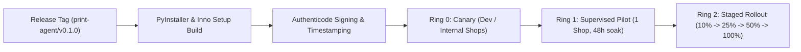

# CAPS Windows Agent — Release, Code Signing & Staged Update Plan

Authoritative release engineering and operational security plan for the CAPS Desktop Print Agent (`apps/print-agent`).

---

## 1. Versioning & Release Tagging Taxonomy

The Windows Print Agent follows strict **Semantic Versioning 2.0.0** (`MAJOR.MINOR.PATCH`).

### 1.1 Git Release Tags
Because the repository is a modular monorepo containing four independently deployable applications, release tags are explicitly scoped to the agent:

- **Format:** `print-agent/v{MAJOR}.{MINOR}.{PATCH}`
- **Examples:**
  - `print-agent/v0.1.0` (Initial MVP production release)
  - `print-agent/v0.1.1` (Hotfix for spooler status race condition)
  - `print-agent/v0.2.0` (Feature release: multi-tray auto-selection)
  - `print-agent/v1.0.0` (General availability milestone)

### 1.2 Binary File Version Resource
Every compiled `.exe` and `.dll` embeds a Windows PE Version Info resource (`apps/print-agent/packaging/version_info.txt`):
- `FileVersion`: 4-digit tuple e.g. `0.1.0.0`
- `ProductVersion`: `0.1.0.0`
- `OriginalFilename`: `caps-agent.exe`
- `ProductName`: `Cloud Automated Printing Solution (CAPS)`

---

## 2. Cryptographic Checksums & Integrity Manifest

To prevent binary tampering, network corruption, or incomplete downloads, every released artifact is fingerprinted with SHA-256 cryptographic hashes.

1. **Generation:** Automated during build by `apps/print-agent/scripts/build.ps1` and `infra/windows-installer/build-installer.ps1`.
2. **Release Manifests:**
   - `build_manifest.json`: Indexes `caps-agent.exe` and bundled runtime DLLs.
   - `installer_manifest.json`: Indexes the setup bootstrap executable (`CAPS-Print-Agent-Setup-*.exe`).
   - `checksums.txt`: SHA-256 hashes formatted for standard `sha256sum -c` verification.

---

## 3. Authenticode Code Signing & Secret Handling

Windows SmartScreen and antivirus heuristics require all release binaries to carry a trusted Authenticode signature.

### 3.1 Security Policies
- **Signature Algorithm:** SHA-256 (SHA-1 is deprecated and forbidden).
- **RFC 3161 Timestamping:** Mandatory (`http://timestamp.digicert.com`). Ensures the binary remains cryptographically valid after certificate expiration.
- **Unsigned Test Builds:** Labeled as `UNTRUSTED`. The agent updater refuses to execute any binary where `is_trusted != True` or `status == "NotSigned"`.

### 3.2 CI/CD Secret Management
Private signing keys must **never** be committed to Git or stored in plaintext:
- **Cloud CI (GitHub Actions):** Stored in GitHub Secrets as `SIGNING_CERT_BASE64` and `SIGNING_CERT_PASSWORD`, or integrated with Azure Trusted Signing / DigiCert KeyLocker cloud HSM.
- **Local Developer Iteration:** Uses `sign-release.ps1 -DryRun` or test certificates installed in `Cert:\CurrentUser\My`.

---

## 4. Staged Rollout Pipeline

Updates are deployed progressively across connected print shops to minimize blast radius in the event of printer driver incompatibilities:

| Deployment Ring | Audience | Soak Time | Promotion Gate Criteria |
| :--- | :--- | :--- | :--- |
| **Ring 0 (Canary)** | Internal engineering & test bench PCs | 24 hours | 0 spooler crashes, clean smoke tests |
| **Ring 1 (Pilot)** | Single supervised shop (Task `P07-M04-F01`) | 48 hours | Zero print job lease drops, 100% telemetry delivery |
| **Ring 2 (Staged)** | 10% $\rightarrow$ 25% $\rightarrow$ 50% $\rightarrow$ 100% of paired shops | 5 days | Error rate $< 0.1\%$, no critical rollback triggers |

---

## 5. In-Agent Updater Security Specification

The desktop agent checks for updates via authenticated outbound polling to the Cloud API:

1. **Update Signal / Poll:** Agent calls `GET /api/v1/agents/update-check` sending its current version (`0.1.0`) and OS version.
2. **Download Isolation:** The update package is downloaded to a restricted temporary directory (`%LOCALAPPDATA%\CAPS\updates`).
3. **Pre-Execution Cryptographic Gates (`UpdatePolicyEngine`):**
   - **Gate 1 (Digest Check):** Compute SHA-256 hash and match against cloud metadata.
   - **Gate 2 (Authenticode Check):** Run `verify_authenticode_signature()`. Ensure status is `Valid` and publisher subject matches `"CAPS Engineering Team"`.
   - **Gate 3 (Version Check):** Ensure target version $>$ current version (prevent accidental downgrades).
4. **Execution:** If and only if all gates pass, invoke installer with `/VERYSILENT /SUPPRESSMSGBOXES /NORESTART`.
5. **Re-attach & Reconcile:** The updated agent starts, reads existing pairing configuration from `%LOCALAPPDATA%\CAPS\agent_pairing.ini`, and reconnects outbound.

---

## 6. Rollback & Disaster Recovery Rules

If an update exhibits driver instability, spooler stalls, or network incompatibilities:

1. **Pairing State Immutability:** Downgrading or reinstalling an agent preserves `%LOCALAPPDATA%\CAPS\agent_pairing.ini` and Windows DPAPI-protected credentials. Operators never have to re-pair printers during a rollback.
2. **Cloud API Backward Compatibility Invariant:** The Cloud API and database schemas are required to support $N$ and $N-1$ agent contract versions simultaneously.
3. **Emergency Downgrade Override:** When cloud administrators trigger an emergency rollback, the Cloud API sets `emergency_rollback: true` in the update payload. The agent's `UpdatePolicyEngine` verifies the administrative signature before executing the lower version installer.
