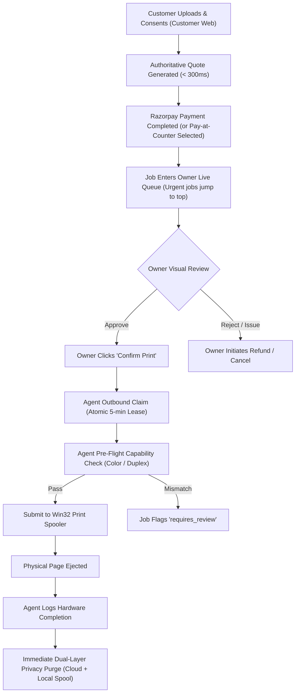

# CAPS — Single-Shop Supervised Pilot Playbook & Operational Runbook (P07-M04-F01)

> **Document:** `tests/e2e/SUPERVISED_PILOT_PLAYBOOK.md`  
> **Status:** Active Field Pilot Playbook  
> **Milestone:** Phase 07 Release QA Pilot -> Module 04 Pilot and Handoff  
> **Assigned Track:** Integration Checkpoint — Jointly Reviewed  

---

## 1. Executive Summary & Pilot Scope

The **Single-Shop Supervised Pilot** represents the final pre-production validation phase of CAPS (Cloud Automated Printing Solution). The pilot operates under strict human operator supervision at a single partner print shop (Shop Alpha), enforcing:
- Explicit owner confirmation for every physical print job (MVP requirement).
- Complete isolation between customer payment, queue management, desktop agent spooling, and Win32 hardware execution.
- **Kiosk mode disabled:** Automated/unattended printing is explicitly disabled.
- Dual-layer privacy purge: Zero persistent customer document retention upon completion or refund.

---

## 2. Invariants & Guardrails Under Pilot Verification

| Invariant | Operational Rule | Verification Mechanism |
|---|---|---|
| **Human Owner Confirmation** | An agent will NEVER claim or print a job without explicit operator approval (`OWNER_CONFIRMED`). | Cloud State Machine & RPC Gate |
| **Kiosk Mode Disabled** | Unattended automatic execution is blocked; unapproved jobs cannot be claimed. | Agent Claim Lease Validator |
| **Single-Use Device Pairing** | Agent pairs via a 6-digit alphanumeric code valid for 15 minutes; code expires upon first successful handshake. | Cloud Pairing Controller |
| **Emergency Stop Kill Switch** | Operator can freeze queue processing instantly during jams, paper-outs, or hardware faults. | In-Memory / DB Shop Queue Mutex |
| **Zero Auto-Reprint** | Ambiguous or unknown Win32 spooler outcomes flag `requires_review`; reprint requires visual output tray confirmation. | Failure Recovery Manager |
| **Immediate Document Purge** | Cloud storage objects and local agent temporary spool files are erased immediately upon ejection or refund. | Document Retention Sweeper |

---

## 3. Morning Opening & Pre-Flight Hardware Calibration

Before accepting customer orders, the shop operator executes the morning calibration protocol:

### Step 1: Desktop Agent Initialization & Pairing
1. Power on Windows Shop PC (Windows 10/11 Pro, 64-bit).
2. Launch `caps-agent.exe` (or activate via loopback system tray).
3. On Owner Dashboard (`https://owner.caps.print/settings`), navigate to **Printers & Agents**.
4. Click **Generate Pairing Code** to receive a code (e.g., `PAIR-CP-789012`).
5. In the Agent UI / CLI:
   ```powershell
   caps-agent pair --code PAIR-CP-789012
   ```
6. Verify status switches to **Online** on dashboard; confirm periodic heartbeats (30s interval).

### Step 2: Diagnostic Printer Test Page
1. Ensure Canon / HP printer has clean A4 paper loaded in Tray 1 and sufficient toner.
2. In Owner Dashboard, click **Print Test Page**.
3. Verify Win32 Spooler receives `CAPS_Diagnostic_Calibration_Page.pdf`.
4. Inspect physical output sheet:
   - [ ] Margins and page alignment (grid lines straight).
   - [ ] Grayscale / color test swatches legible.
   - [ ] Duplex alignment marks aligned if double-sided.
5. Sign off morning calibration in the daily logbook.

---

## 4. Live Shift Operations & Order Processing Protocol



### Shift Rules:
1. **Urgent Orders:** Surcharged `urgent` jobs appear with red badges at the top of the queue and must be approved first.
2. **Pay-at-Counter Orders:** Verify customer cash receipt before clicking **Confirm Cash & Print**.
3. **Customer Consent:** Every uploaded job carries verified customer consent for cloud processing and automatic deletion.

---

## 5. Exception Handling & Customer Support Runbook

### Scenario 1: Hardware Fault (Paper Jam, Toner Depleted, Tray Empty)
1. **Action:** Click **Emergency Stop** in header to pause queue processing.
2. Inspect printer hardware; remove jammed paper or reload paper tray.
3. If job partially printed:
   - Check Win32 Spooler status. If status is `UNKNOWN`, check physical tray.
   - If document is incomplete: select **Retry Job** to re-queue.
   - If document is undamaged: select **Confirm Printed**.
4. Click **Resume Queue** to re-enable automated agent claims.

### Scenario 2: Customer Cancellation & Payment Refund
1. Customer requests cancellation before physical printing.
2. In Owner Dashboard `/queue`, select the job and click **Issue Refund**.
3. Select reason code:
   - `CUSTOMER_REQUESTED_CANCELLATION`
   - `UNRECOVERABLE_HARDWARE_FAULT`
   - `OPERATOR_REJECTED_CONTENT`
4. Confirm refund amount in paise.
5. System triggers automatic Razorpay refund via Cloud API, transitions payment to `refunded`, cancels job, and immediately deletes customer document from private cloud storage.

---

## 6. Evening Closing & Privacy Audit Checklist

At the conclusion of the operating shift, the operator executes the privacy audit:

1. **Active Queue Verification:** Confirm all completed and cancelled jobs are cleared.
2. **Local Disk Cleanup:**
   - Check `C:\ProgramData\CAPS\spool\` on Windows PC.
   - Verify folder contains **0 files** (all temp raster PDFs purged).
3. **Cloud Storage Verification:** Verify retention cleaner ran without errors.
4. **Agent Graceful Shutdown:** Right-click CAPS Agent tray icon -> select **Exit**.
5. **Sign off Evening Logsheet.**

---

## 7. Pilot Certification Signoff Form

| Role | Name | Date | Status |
|---|---|---|---|
| **Shop Owner / Operator** | ____________________ | ____/____/2026 | `[ ] SIGNED OFF` |
| **Integration Lead** | ____________________ | ____/____/2026 | `[ ] SIGNED OFF` |
| **QA Pilot Supervisor** | ____________________ | ____/____/2026 | `[ ] SIGNED OFF` |
